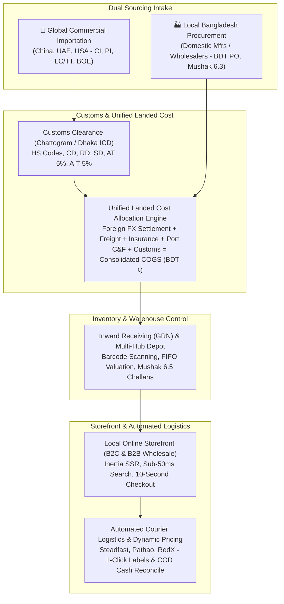

# Enterprise Single-Vendor E-Commerce Platform
### High-Scale Turnkey Hybrid Trading Solution (Global Importation + Local Sourcing $\rightarrow$ Domestic Storefront)

[](https://laravel.com)
[](https://vuejs.org)
[](https://inertiajs.com)
[](https://www.typescriptlang.org)
[](https://sass-lang.com)
[](https://php.net)

---

## 1. Commercial Business Model & Architecture

This platform is engineered specifically as a **Turnkey Commercial Trading E-Commerce Solution** tailored for Bangladesh and international trade. It is strictly a **Pure Trading Business** (Finished Goods In $\rightarrow$ Retail & Wholesale Out; no manufacturing, assembly routing, or BOM).

### Dual Sourcing Lifecycle


---

## 2. Core Enterprise Pillars

### A. 7-Layer Anti-Fraud & Fake Order Defense Shield
1. **Invisible Bot Honeypots & Submission Timing Guards**: Blocks automated scrapers and submissions completed in `< 3.5 seconds`.
2. **Bangladesh Mobile Number Validation**: Strict carrier regex (`+8801[3-9]\d{8}`) and repeating dummy digit rejection (`01711111111`).
3. **Cross-Courier Delivery Success Rate API**: Automated queries to **Steadfast Return Rate API** and **Pathao Success API**; customer courier history determines risk scores.
4. **Natural Language Address Sanity**: Shannon entropy algorithm filters keyboard mash; cascading BD Division $\rightarrow$ District $\rightarrow$ Thana hierarchy prevents undeliverable orders.
5. **Velocity & Stock Hoarding Throttles**: Maximum 1 active unfulfilled COD order per phone number.
6. **Tiered Automated Enforcement**:
   - **Low Risk (0–29)**: Auto-approved directly to warehouse picking.
   - **Medium Risk (30–69)**: Mandatory SMS/WhatsApp 4-digit OTP with 15-minute stock hold TTL.
   - **High Risk (70–100 or Courier Return Rate > 40%)**: **COD Disabled!** Customer must prepay delivery charges (৳70/৳150) via bKash/Nagad before shipment.
   - **Blacklisted**: Immediate rejection.
7. **Merchant Fraud Directory (`customer_fraud_lists`)**: 1-click blacklisting of phone/IP/fingerprint directly from admin order details.

### B. AI Automated Outbound Voice Calling Verification Agent
- Automatically dials the customer's mobile number within 60 seconds of placing a COD order.
- Speaks natural bilingual **Bangla (বাংলা)** or **English**.
- Dual confirmation: **DTMF Touch-Tone** (Press 1 to confirm, 2 to cancel) or **Conversational Speech-to-Intent AI**.
- Admin back-office UI with instant Active/Inactive toggle, provider drivers (**Twilio Voice**, **Vapi.ai**, **Retell AI**, **Local Telco OBD**), and **"Make Test Call"** pre-flight button.

### C. Enterprise Media & Dynamic Multi-Cloud Storage
- Standardized on **Spatie Laravel MediaLibrary** (`spatie/laravel-medialibrary`) + **Intervention Image v3** (`intervention/image`).
- Automatic background conversion to **WebP** and **AVIF** with responsive breakpoints (`300`, `600`, `1200`, `2000`).
- Blurhash / LQIP placeholders for zero layout shift (**Cumulative Layout Shift CLS = 0.0**).
- **Dynamic Multi-Cloud Storage Engine**: Back-office dropdown selector with pre-flight **"Test Storage Connection"** button:
  - **Local Server Storage** (`storage/app/public/media/`)
  - **Google Cloud Storage (GCS)** (Service Account JSON)
  - **Amazon AWS S3** (S3 Bucket + CloudFront CDN)
  - **Cloudflare R2** (**Zero Egress Bandwidth Fees** for high-res images)
  - **MinIO / DigitalOcean Spaces**

### D. Role-Based Access Control (RBAC) Management
- Standardized on **Spatie Laravel Permission** (`spatie/laravel-permission`).
- Dedicated back-office admin UI with pre-configured trading roles (`Super Admin`, `Operations Manager`, `Procurement Officer`, `Warehouse Keeper`, `Accounts & VAT Officer`, `Logistics Dispatcher`, `Customer Care Agent`).
- Interactive Vue 3 matrix grid grouping permissions by module with "Select All" toggles.
- Protected Super Admin role with `Gate::before` bypass.

### E. Automated Courier Logistics & Dynamic Shipping Pricing
- Dynamic courier drivers: **Steadfast**, **Pathao**, **RedX**, **Paperfly**, **Sundarban**, and DHL/FedEx.
- Zone-based pricing: Inside Dhaka, Dhaka Suburbs, Outside Dhaka, extra weight per kg, free shipping thresholds.
- 1-click consignment booking, 4x6 inch thermal barcode shipping labels, live tracking webhooks, and automated COD cash reconciliation.

### F. Dynamic Payment Gateway Management
- Back-office UI for Bangladesh MFS (**bKash Tokenized**, **Nagad**, **SSLCommerz**) and global gateways (Stripe, COD, Bank Wire).
- Encrypted credentials storage with pre-flight **"Test API Connection"** automated handshake.

### G. Bangladesh NBR VAT & Income Tax Compliance Engine
- Automated **Mushak 6.3** Tax Invoices with atomic non-gap serial locks.
- Claiming import Advance Tax (AT - 5%) and local supplier VAT as **Input Tax Credit (রেয়াত)** on monthly **Mushak 9.1** returns.
- Statutory **Mushak 6.6** VDS Certificates, **Mushak 6.7** Credit Notes for returns with decreasing tax adjustments, **Mushak 6.8** Debit Notes, and **Mushak 6.5** Transfer Challans.
- TDS & AIT tracking under the Income Tax Act 2023.

### H. 100% SEO, Social Commerce & Frictionless UX
- **Inertia SSR** for search crawler indexing and rich social previews.
- Schema.org JSON-LD rich snippets (`Product`, `BreadcrumbList`, `Organization`, `FAQPage`).
- Google Merchant Center XML feed, Facebook Catalog sync, TikTok catalog exports.
- Sub-50ms instant search with autocomplete and typo tolerance, 1-page/drawer checkout, and slide-out cart drawer with dynamic free shipping bar.

---

## 3. Modular Monolith Directory Structure (`app/Modules/`)

```text
app/
├── Modules/
│   ├── Catalog/              # Products, Categories, Brands, Matrix Variants, MediaLibrary
│   ├── Procurement/          # Global Imports (CI, LC/TT, BOE) & Local Suppliers (Mushak 6.3), Landed Cost
│   ├── Inventory/            # Multi-Warehouse/Hubs, Stock Tracking, Barcode GRN, FIFO, Mushak 6.5
│   ├── Pricing/              # B2C Retail Pricing, B2B Tier Pricing, Discounts, Volume Breaks
│   ├── Cart/                 # Persistent Cart, Slide-Out Drawer, Free Shipping Bar, Abandoned Cart
│   ├── Order/                # Order State Machine, Fraud Risk Scoring, Honeypots, Courier Booking
│   ├── Payment/              # Dynamic Gateway Drivers (bKash, Nagad, SSLCommerz, Stripe)
│   ├── Logistics/            # Courier Drivers (Steadfast, Pathao, RedX), Shipping Labels, Zone Pricing
│   ├── Communication/        # SMS Gateways, WhatsApp API, Voice Calling AI Agent, SMTP Settings
│   ├── Marketing/            # Abandoned Cart Sequences, Reward Points, Referrals, Flash Sales
│   ├── AI/                   # Pluggable Multi-Model AI Engine (Gemini, OpenAI, Claude, Ollama)
│   ├── Seo/                  # Dynamic Sitemaps, Schema.org Generators, Meta DTOs, Robots.txt
│   ├── TaxCompliance/        # NBR VAT (Mushak 6.3, 6.7, 6.8, 6.5, 6.6, 9.1), Input Credit, TDS, AIT
│   ├── Customer/             # Auth, Profiles, Cascading BD Addresses, Fraud Blacklist/Whitelist
│   └── Admin/                # Roles & Permissions UI, Multi-Cloud Storage UI, reCAPTCHA, Trading Analytics
```

---

## 4. Development Workflow

### Prerequisites
- **PHP**: 8.3+ (PHP 8.5 compatible) with `curl`, `fileinfo`, `gd`, `intl`, `mbstring`, `openssl`, `pdo_mysql`, `zip`
- **Node.js**: v20+
- **Composer**: 2.8+
- **Database**: MySQL 8.0+ or MariaDB 10.11+
- **Cache**: Redis 7.0+

### Key Commands
```bash
# Backend development server
php artisan serve

# Frontend Vite development server with Sass compiler
npm run dev

# Run backend tests
php artisan test

# Build frontend production bundle & SSR bundle
npm run build
npm run build:ssr

# PHP code styling (PSR-12)
./vendor/bin/pint
```

---

## 5. Architectural & Behavioral Guidelines
For full domain rules, compliance formulas, anti-fraud algorithms, and coding standards, refer to:
- [AGENTS.md](file:///c:/working/ts/ecommerce/AGENTS.md)
- [GEMINI.md](file:///c:/working/ts/ecommerce/GEMINI.md)
